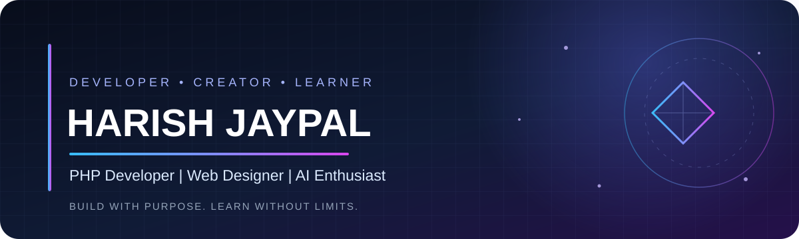

 

 

---

## 👨‍💻 About Me

Hey! I'm **Harish Jaypal** — a developer who enjoys creating for the web and exploring what comes next in technology.

- 💻 **Building with:** PHP, HTML, CSS and JavaScript
- 🗄️ **Working with:** MySQL and web development tools
- 🌱 **Learning:** Python, AI fundamentals and Large Language Models
- 🎯 **North Star:** Become an AI Developer and build useful real-world products
- ⚡ **Mindset:** Learn by building. Improve by experimenting.

> I don't just want to use technology — I want to understand it, build it, and make it useful.

## ⚙️ Tech Arsenal

**Web & Programming**

**Tools**

## 📊 GitHub Analytics

  
  
   
  

## 🏆 Contribution Trophies

  

## 🚀 What I'm Focused On

| Focus | What I'm doing |
|---|---|
| Web Development | Improving PHP and frontend development |
| Databases | Practising MySQL and data-driven applications |
| Python | Strengthening programming fundamentals |
| Artificial Intelligence | Exploring AI concepts and LLMs |
| Building | Turning learning into practical projects |

## 📈 Contribution Activity

  

---

## 🤝 Connect

  

**Thanks for visiting!**  
*Keep learning. Keep building. Keep moving forward.* ✨

